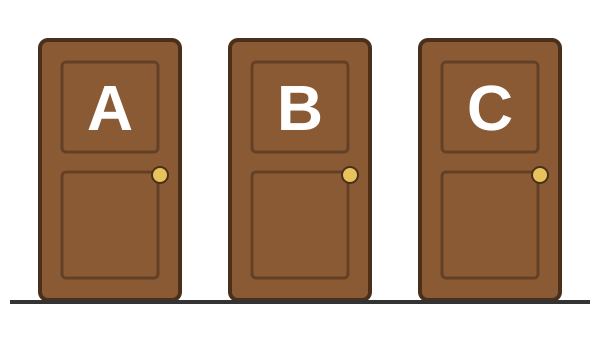

# Programming Challenge: the Monty Hall problem

## The Monty Hall problem

::::: columns
::: {.column width="45%"}
{fig-alt="Three closed doors labelled A, B and C"}
:::

::: {.column width="55%"}
1.  Behind one door is a car; behind the other two are goats
2.  You pick a door, say A
3.  The host, who knows where the car is, opens another door with a goat behind it, say C
4.  You may stay with A or switch to B
:::
:::::

::: fragment
Should you stay or switch?
:::

## What would you choose?

-   Stay or switch? Vote!
-   Write down your reasoning: you will check it against your own simulation

## Challenge

-   Open the [`lab_monty_hall`](https://github.com/xcit-courses/R-intro-labs/tree/main/lab_monty_hall) lab from the course labs on GitHub
-   If you don't have R and RStudio running locally, you can use the following [Binder link](https://mybinder.org/v2/gh/xcit-courses/R-intro-labs/HEAD?urlpath=rstudio) instead
-   Note however that your progress will not be saved if you use Binder!

## Debrief: stay or switch?

-   In the simulations, switching wins about 2 games out of 3
-   Why? Your first pick is right only 1 time in 3
-   The host never opens your door or the car's door: so when your first pick is wrong (2 times in 3), the other closed door hides the car

::: fragment
More: <https://en.wikipedia.org/wiki/Monty_Hall_problem>
:::
